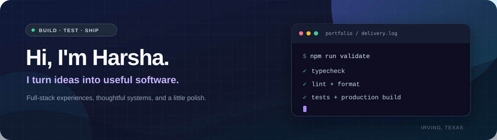

  

  
  
  

<h2 align="center">✨ Featured build</h2>

<h3 align="center"><a href="https://harsha2000-developer.github.io/portfolio/">A portfolio, built like a product</a></h3>

  A modular React site for exploring my work, technical interests, and story. 
  Designed for the web, with a dark/light theme and a direct path from live experience to source.

<table>
  <tr>
    <td align="center" width="33%">
      <h3>🎨 Interface</h3>
      React 19 TypeScript Tailwind CSS 4
    </td>
    <td align="center" width="33%">
      <h3>🧪 Quality</h3>
      Type checks Linting &amp; formatting Component tests
    </td>
    <td align="center" width="33%">
      <h3>🚀 Delivery</h3>
      Vite static build Docker + Nginx Security headers
    </td>
  </tr>
</table>

  <a href="https://github.com/Harsha2000-Developer/portfolio"><strong>Open the repository →</strong></a>
  &nbsp;·&nbsp;
  <a href="https://github.com/Harsha2000-Developer?tab=repositories">More public repositories</a>

<h2 align="center">🧰 Built with</h2>

  
  
  
  
  
  

  <a href="mailto:harsha.g.techdeveloper@gmail.com">Say hello</a>
  &nbsp;·&nbsp;
  <a href="https://www.linkedin.com/in/harsha-us/">Find me on LinkedIn</a>

